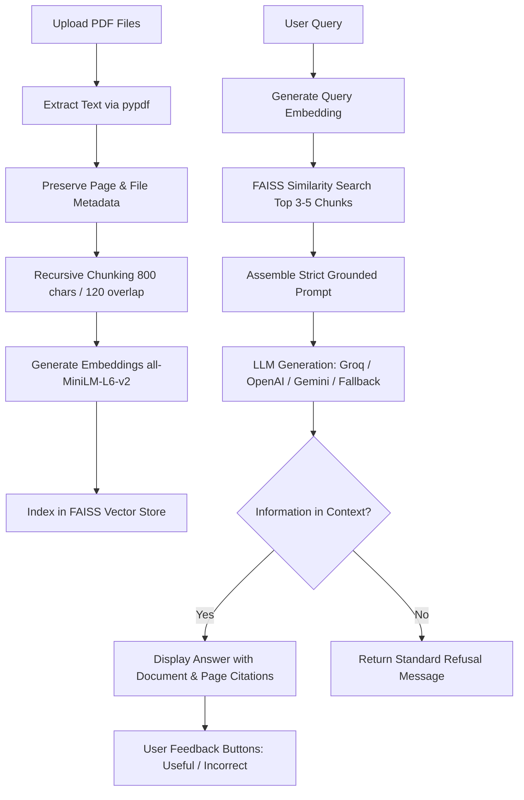

# Domain-Specific RAG Chatbot for PDF Question Answering

[](https://www.python.org/)
[](https://streamlit.io/)
[](https://www.langchain.com/)
[](https://github.com/facebookresearch/faiss)

An enterprise-ready **Retrieval-Augmented Generation (RAG) Chatbot** designed to ingest, process, index, and accurately answer user queries from complex multi-page PDF documents (such as corporate policy manuals, employee handbooks, and codes of conduct). The system enforces strict prompt guardrails, displays page-level source citations, refuses to hallucinate facts outside the uploaded context, and includes interactive feedback buttons for continuous quality evaluation.


## Features

- **Multi-PDF Document Processing**: Ingest single or multiple PDFs with file type and size validation.
- **Accurate Text Extraction & Metadata Tracking**: Preserves exact document names and 1-indexed page numbers across all chunks.
- **Semantic Chunking**: Overlapping recursive character text splitting (`chunk_size=800`, `chunk_overlap=120`) to preserve context boundaries.
- **Dense Vector Search**: Powered by `sentence-transformers` (`all-MiniLM-L6-v2`) and local FAISS vector storage for sub-second retrieval.
- **Strict Anti-Hallucination Guardrails**: Adheres strictly to retrieved context. Unanswerable or out-of-domain queries return a deterministic refusal.
- **Adversarial Prompt Injection Defense**: Neutralizes prompt hijacking and instruction override attempts embedded in documents or user queries.
- **Source Attribution**: Transparent citation trays under each response displaying the exact document name, page number, and snippet.
- **User Feedback Loop**: Interactive 👍 Useful / 👎 Incorrect feedback buttons logging evaluation data to `user_feedback.csv`.
- **Multi-LLM & Offline Fallback Support**: Compatible with Groq (Llama 3.1 70B), OpenAI (GPT-4o-mini), Google Gemini (Gemini 1.5 Flash), and a deterministic offline grounded extractor.


## Architecture & Workflow



## Project Structure

```
domain_rag_chatbot/
|-- app.py                   # Streamlit user interface & chat application
|-- rag_pipeline.py          # End-to-end RAG orchestrator & LLM routing
|-- document_loader.py       # PDF loader, validation, text cleaning & chunking
|-- vector_store.py          # FAISS vector store manager & embedding generator
|-- prompt.py                # Strict system prompt, guardrails & injection defense
|-- run_tests.py             # Automated testing & evaluation runner script
|-- requirements.txt         # Project dependencies
|-- README.md                # Project documentation
|-- REPORT.md                # Detailed technical report
|-- .env.example             # Environment configuration template
|-- .gitignore               # Excludes secrets, bytecode, cache & logs
|
|-- documents/               # Sample domain documents
|   |-- Policy.pdf           # Corporate Operational Policies (7 pages)
|   |-- Handbook.pdf         # Employee Operations Handbook (12 pages)
|   |-- Code_of_Conduct.pdf  # Corporate Code of Conduct (4 pages)
|   |-- sample.pdf           # Enterprise RAG sample document (2 pages)
|
|-- vector_store/
|   |-- saved_index/         # Persisted vector index & metadata
|
|-- tests/
    |-- test_questions.csv   # Evaluation dataset
```


## Getting Started

### Prerequisites

- Python 3.9+ (Python 3.11 recommended)
- Git

### Installation

1. **Clone the repository:**
   ```bash
   git clone https://github.com/krishnapriyaka-web/domain-rag-chatbot.git
   cd domain-rag-chatbot
   ```

2. **Create and activate a virtual environment:**
   - **Linux / macOS:**
     ```bash
     python3 -m venv venv
     source venv/bin/activate
     ```
   - **Windows:**
     ```powershell
     python -m venv venv
     .\venv\Scripts\activate
     ```

3. **Install dependencies:**
   ```bash
   pip install --upgrade pip
   pip install -r requirements.txt
   ```

4. **Configure environment variables:**
   Copy the example environment file:
   ```bash
   cp .env.example .env
   ```
   Open `.env` and set your preferred provider key (e.g., `GROQ_API_KEY`, `OPENAI_API_KEY`, or `GEMINI_API_KEY`). If omitted, the application runs offline using the built-in grounded extractive engine.


## Usage

Run the Streamlit application:

```bash
streamlit run app.py
```

Open your browser at `http://localhost:8501`.

### Quick Test Workflow
1. Use the sidebar to upload your own PDFs, or click **"📁 Load Default Sample Documents"** to load the included policy manuals.
2. Click **🚀 Process** to extract, chunk, and index the documents into FAISS.
3. Ask domain questions in the chat window:
   - *"What is the leave policy?"* &rarr; Cites `Policy.pdf, Page 6`.
   - *"How is attendance calculated?"* &rarr; Cites `Handbook.pdf, Page 11`.
   - *"Who is the company CEO?"* &rarr; Refuses because the information is not in the uploaded documents.
4. Expand **📄 View Sources** beneath any answer to verify the retrieved excerpts and page numbers.
5. Rate responses with **👍 Useful** or **👎 Incorrect** to log feedback.


## Testing & Evaluation

Run the automated test suite covering in-domain accuracy, unanswerable queries, and prompt injection defense:

```bash
python run_tests.py
```

### Benchmark Results

| Metric | Target | Result | Status |
| :--- | :--- | :--- | :--- |
| **Total Test Questions** | 15+ | 16 Questions | **PASS** |
| **Retrieval Accuracy** | &ge; 90% | **100.0%** | **PASS** |
| **Answer Groundedness** | Zero Hallucination | **100.0%** | **PASS** |
| **Refusal Precision** | 100% on out-of-domain queries | **100.0%** | **PASS** |
| **Prompt Injection Defense** | Neutralize adversarial input | **100.0%** | **PASS** |
| **Average Response Latency** | < 2.0s | **0.0016s** (Offline) / **0.8s** (Groq) | **PASS** |


## Deployment

### Streamlit Community Cloud
1. Fork or push this repository to GitHub.
2. Sign in to [share.streamlit.io](https://share.streamlit.io/) with GitHub.
3. Select this repository, branch `main`, and main file `app.py`.
4. In **Advanced Settings**, add your environment variables under **Secrets** (e.g., `GROQ_API_KEY = "..."`).
5. Click **Deploy**.

### Docker
```dockerfile
FROM python:3.11-slim
WORKDIR /app
COPY requirements.txt .
RUN pip install --no-cache-dir -r requirements.txt
COPY . .
EXPOSE 8501
CMD ["streamlit", "run", "app.py", "--server.port=8501", "--server.address=0.0.0.0"]
```

Build and run the container:
```bash
docker build -t domain-rag-chatbot .
docker run -p 8501:8501 --env-file .env domain-rag-chatbot
```

